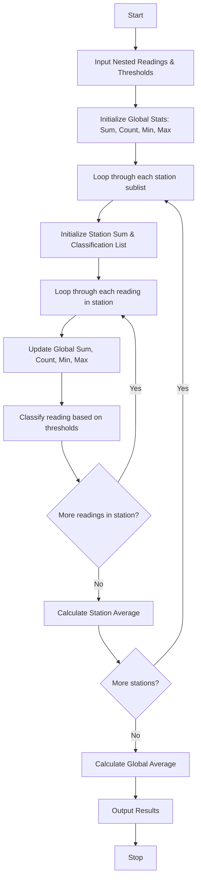

## Problem Statement

Design a program that analyzes nested lists of environmental monitoring data (such as PM2.5 air-quality readings across multiple monitoring stations or time intervals). The program must calculate global and station-specific averages, identify extreme values (minimum and maximum readings), and classify each individual observation into predefined categories (e.g., Good, Moderate, Unhealthy) based on supplied threshold values.

---

## Algorithm

1. **Initialize** variables to store the global sum, global count, global maximum (`-inf`), and global minimum (`inf`).
2. **Accept** a nested list of numerical readings and a dictionary of threshold values.
3. **Iterate** through each sublist (station) in the nested list:
* Initialize a local sum for the current station.
* Iterate through each reading within the station:
* Add the reading to the global sum and increment the global count.
* Update the global maximum and minimum if applicable.
* Add the reading to the station sum.
* Compare the reading against the thresholds (`good`, `moderate`) to assign a classification label.


* Compute the station average and store it.


4. **Compute** the global average by dividing the total global sum by the global count.
5. **Return** or display the summary statistics (global average, extremes, station averages) alongside the classified observations.

---

## Flowchart



---


## Sample Input

```json
{
  "data": [
    [35.5, 42.0, 58.2],
    [15.1, 22.4, 19.8],
    [85.0, 92.5, 110.0]
  ],
  "thresholds": {
    "good": 50.0,
    "moderate": 100.0
  }
}

```

---

## Sample Output

```json
{
  "global_average": 53.388888888888886,
  "global_maximum": 110.0,
  "global_minimum": 15.1,
  "station_averages": [
    [0, 45.233333333333334],
    [1, 19.1],
    [2, 95.83333333333333]
  ],
  "classified_observations": [
    [[35.5, "Good"], [42.0, "Good"], [58.2, "Moderate"]],
    [[15.1, "Good"], [22.4, "Good"], [19.8, "Good"]],
    [[85.0, "Moderate"], [92.5, "Moderate"], [110.0, "Unhealthy"]]
  ]
}

```
