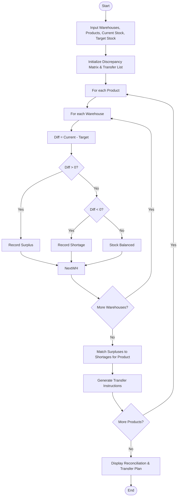

Here is a complete, production-ready solution for **Inventory Matrix Reconciliation**, covering the problem statement, algorithm, Mermaid flowchart, Python source code, sample input, and sample output.

---

 1. Problem Statement

Managing inventory across a multi-warehouse network often leads to localized imbalances where some warehouses hold excess stock (surpluses) while others face deficits (shortages).

Given current stock quantities and specified target stock levels for multiple products across several warehouses using **nested lists (matrices)**:

* **Objective:** Compare current vs. target stock levels, identify surpluses and shortages per warehouse-product pair, and generate an optimal inter-warehouse transfer plan to meet all stock targets efficiently.

---
2. Algorithm

1. **Initialize Inputs:** Accept lists of `warehouses`, `products`, and 2D matrices for `current_stock` and `target_stock`.
2. **Reconciliation Pass:**
* Iterate through each product and warehouse.
* Calculate stock difference: $\text{Difference} = \text{Current Stock} - \text{Target Stock}$.
* Categorize the status:
* If $\text{Difference} > 0 \rightarrow$ **Surplus** (Excess stock available to send).
* If $\text{Difference} < 0 \rightarrow$ **Shortage** (Deficit stock needed to receive).
* If $\text{Difference} == 0 \rightarrow$ **Balanced**.


3. Transfer Calculation (Greedy Matching per Product):
* For each product, group all surplus sources and shortage destinations.
* Sequentially match surplus warehouses to shortage warehouses:
* Transfer quantity = $\min(\text{available surplus}, \text{required shortage})$.
* Record the transfer instruction (`From Warehouse` $\rightarrow$ `To Warehouse`).
* Update remaining surplus and shortage amounts until all deficits are met or surpluses are exhausted.


4. Output Generation: Present the reconciliation status matrix and the itemized transfer schedule.

---

3. Flowchart (Mermaid)



---

 4. Python Source Code

```python
def reconcile_inventory(warehouses, products, current_stock, target_stock):
    """
    Reconciles inventory across warehouses and calculates required transfers.
    """
    num_warehouses = len(warehouses)
    num_products = len(products)
    
    reconciliation_results = []
    transfer_plan = []
    
    # Step 1: Calculate shortages and surpluses per product
    for j in range(num_products):
        product_name = products[j]
        surpluses = []
        shortages = []
        
        for i in range(num_warehouses):
            wh_name = warehouses[i]
            curr = current_stock[i][j]
            targ = target_stock[i][j]
            diff = curr - targ
            
            status = "Balanced"
            if diff > 0:
                status = "Surplus"
                surpluses.append({"warehouse": wh_name, "amount": diff})
            elif diff < 0:
                status = "Shortage"
                shortages.append({"warehouse": wh_name, "amount": abs(diff)})
                
            reconciliation_results.append({
                "warehouse": wh_name,
                "product": product_name,
                "current": curr,
                "target": targ,
                "difference": diff,
                "status": status
            })
            
        # Step 2: Match surpluses to shortages for this product (Greedy Strategy)
        active_surpluses = [s.copy() for s in surpluses]
        active_shortages = [sh.copy() for sh in shortages]
        
        s_idx, sh_idx = 0, 0
        while s_idx < len(active_surpluses) and sh_idx < len(active_shortages):
            surplus_item = active_surpluses[s_idx]
            shortage_item = active_shortages[sh_idx]
            
            transfer_qty = min(surplus_item["amount"], shortage_item["amount"])
            
            if transfer_qty > 0:
                transfer_plan.append({
                    "product": product_name,
                    "from_warehouse": surplus_item["warehouse"],
                    "to_warehouse": shortage_item["warehouse"],
                    "quantity": transfer_qty
                })
                
            surplus_item["amount"] -= transfer_qty
            shortage_item["amount"] -= transfer_qty
            
            if surplus_item["amount"] == 0:
                s_idx += 1
            if shortage_item["amount"] == 0:
                sh_idx += 1
                
    return reconciliation_results, transfer_plan


# --- Sample Execution ---
if __name__ == "__main__":
    warehouses = ["Warehouse A", "Warehouse B", "Warehouse C"]
    products = ["Laptop", "Monitor", "Keyboard"]
    
    # Rows: Warehouses, Columns: Products (Laptop, Monitor, Keyboard)
    current_stock = [
        [50, 20, 100],  # Warehouse A current stock
        [10, 40, 30],   # Warehouse B current stock
        [30, 30, 50]    # Warehouse C current stock
    ]
    
    target_stock = [
        [30, 30, 60],   # Warehouse A target stock
        [30, 30, 60],   # Warehouse B target stock
        [30, 30, 60]    # Warehouse C target stock
    ]
    
    results, transfers = reconcile_inventory(warehouses, products, current_stock, target_stock)
    
    print("=== RECONCILIATION SUMMARY ===")
    for r in results:
        print(f"[{r['warehouse']}] Product: {r['product']} | Current: {r['current']} | Target: {r['target']} | Diff: {r['difference']:+d} ({r['status']})")
        
    print("\n=== REQUIRED TRANSFER PLAN ===")
    if not transfers:
        print("No transfers needed. All warehouses meet target stock.")
    for t in transfers:
        print(f"👉 Transfer {t['quantity']} units of {t['product']} from {t['from_warehouse']} ➔ {t['to_warehouse']}")

```

---

 5. Sample Input

* **Warehouses:** `["Warehouse A", "Warehouse B", "Warehouse C"]`
* **Products:** `["Laptop", "Monitor", "Keyboard"]`
* **Current Stock Matrix (`current_stock`):**

$$\begin{bmatrix} 50 & 20 & 100 \\ 10 & 40 & 30 \\ 30 & 30 & 50 \end{bmatrix}$$


* **Target Stock Matrix (`target_stock`):**

$$\begin{bmatrix} 30 & 30 & 60 \\ 30 & 30 & 60 \\ 30 & 30 & 60 \end{bmatrix}$$


---

6. Sample Output

```text
=== RECONCILIATION SUMMARY ===
[Warehouse A] Product: Laptop | Current: 50 | Target: 30 | Diff: +20 (Surplus)
[Warehouse A] Product: Monitor | Current: 20 | Target: 30 | Diff: -10 (Shortage)
[Warehouse A] Product: Keyboard | Current: 100 | Target: 60 | Diff: +40 (Surplus)
[Warehouse B] Product: Laptop | Current: 10 | Target: 30 | Diff: -20 (Shortage)
[Warehouse B] Product: Monitor | Current: 40 | Target: 30 | Diff: +10 (Surplus)
[Warehouse B] Product: Keyboard | Current: 30 | Target: 60 | Diff: -30 (Shortage)
[Warehouse C] Product: Laptop | Current: 30 | Target: 30 | Diff: +0 (Balanced)
[Warehouse C] Product: Monitor | Current: 30 | Target: 30 | Diff: +0 (Balanced)
[Warehouse C] Product: Keyboard | Current: 50 | Target: 60 | Diff: -10 (Shortage)

=== REQUIRED TRANSFER PLAN ===
👉 Transfer 20 units of Laptop from Warehouse A ➔ Warehouse B
👉 Transfer 10 units of Monitor from Warehouse B ➔ Warehouse A
👉 Transfer 30 units of Keyboard from Warehouse A ➔ Warehouse B
👉 Transfer 10 units of Keyboard from Warehouse A ➔ Warehouse C

```
