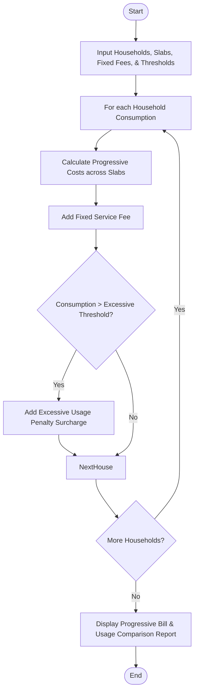

Here is the complete solution for the **Progressive Water Tariff Analysis** problem, structured according to your requirements without any comments in the Python code.

---

## 1. Problem Statement

Municipal water authorities use progressive slab-based tariff structures to promote conservation and manage water distribution across households.

Given consumption records for multiple households, tiered tariff rate slabs, fixed service fees, and an excessive usage threshold with associated penalties:

* **Objective:** Compute individual water bills using progressive slab calculations, add fixed fees and penalties for excessive consumption, compare household usage patterns, and flag excessive users.

---

## 2. Algorithm

1. **Input Collection:** Receive household consumption values, slab structures (tier limits and corresponding unit rates), fixed service fees, an excessive usage threshold, and a penalty fee.
2. **Progressive Bill Calculation:** For each household, calculate the cost tier by tier:
* Allocate consumption sequentially into the defined slabs.
* Multiply allocated volume by the tier's unit rate and accumulate the base bill.


3. **Fixed Fee & Penalty Application:**
* Add the standard fixed service fee to the base bill.
* Check if total consumption exceeds the excessive usage threshold; if so, apply the penalty surcharge.


4. **Analysis & Comparison:** Aggregate bill statements and status flags (Normal vs. Excessive) for all households.
5. **Output Generation:** Display the comprehensive billing and consumption comparison report.

---

## 3. Flowchart (Mermaid)



---

## 4. Python Source Code

```python
def calculate_water_bills(households, slabs, fixed_fee, excessive_threshold, penalty_amount):
    billing_reports = []
    
    for name, consumption in households:
        remaining = consumption
        tier_cost = 0.0
        
        for limit, rate in slabs:
            if remaining <= 0:
                break
            slab_usage = min(remaining, limit)
            tier_cost += slab_usage * rate
            remaining -= slab_usage
            
        if remaining > 0:
            highest_rate = slabs[-1][1]
            tier_cost += remaining * highest_rate
            
        total_bill = tier_cost + fixed_fee
        is_excessive = consumption > excessive_threshold
        
        penalty = 0.0
        if is_excessive:
            penalty = penalty_amount
            total_bill += penalty
            
        billing_reports.append({
            "household": name,
            "consumption": consumption,
            "base_cost": round(tier_cost, 2),
            "fixed_fee": fixed_fee,
            "penalty": penalty,
            "total_bill": round(total_bill, 2),
            "status": "Excessive" if is_excessive else "Normal"
        })
        
    return billing_reports


if __name__ == "__main__":
    tariff_slabs = [
        (15.0, 1.20),   # Tier 1: Up to 15 KL @ $1.20 per KL
        (15.0, 2.50),   # Tier 2: Next 15 KL (15 to 30 KL) @ $2.50 per KL
        (float('inf'), 4.50)  # Tier 3: Above 30 KL @ $4.50 per KL
    ]
    
    fixed_service_fee = 15.0
    excessive_usage_threshold = 40.0
    penalty_surcharge = 30.0
    
    households_data = [
        ("Greenwood Villa", 12.0),
        ("Maple Heights", 28.0),
        ("Oakridge Estate", 45.0),
        ("Pinecrest Apt", 10.0),
        ("Sunrise Manor", 55.0)
    ]
    
    reports = calculate_water_bills(
        households_data, 
        tariff_slabs, 
        fixed_service_fee, 
        excessive_usage_threshold, 
        penalty_surcharge
    )
    
    print("=== PROGRESSIVE WATER TARIFF ANALYSIS REPORT ===")
    print("Household      | Usage (KL) | Base Cost | Fixed | Penalty | Total Bill | Status")
    print("-" * 78)
    for r in reports:
        print(f"{r['household']:<14} | {r['consumption']:<10} | ${r['base_cost']:<8} | ${r['fixed_fee']:<5} | ${r['penalty']:<7} | ${r['total_bill']:<10} | {r['status']}")

```

---

## 5. Sample Input

* **Tariff Slabs `(Tier Capacity in KL, Rate per KL)`:**
* Tier 1: `(15.0, $1.20)`
* Tier 2: `(15.0, $2.50)`
* Tier 3: `(Infinite, $4.50)`


* **Fixed Service Fee:** `$15.0`
* **Excessive Usage Threshold:** `40.0 KL`
* **Penalty Surcharge:** `$30.0`
* **Households Data `(Household Name, Consumption in KL)`:**
```python
[
    ("Greenwood Villa", 12.0),
    ("Maple Heights", 28.0),
    ("Oakridge Estate", 45.0),  # Exceeds threshold (triggers penalty)
    ("Pinecrest Apt", 10.0),
    ("Sunrise Manor", 55.0)     # Exceeds threshold (triggers penalty)
]

```


---

## 6. Sample Output

```text
=== PROGRESSIVE WATER TARIFF ANALYSIS REPORT ===
Household      | Usage (KL) | Base Cost | Fixed | Penalty | Total Bill | Status
------------------------------------------------------------------------------
Greenwood Villa | 12.0       | $14.4     | $15.0 | $0.0    | $29.4      | Normal
Maple Heights   | 28.0       | $52.0     | $15.0 | $0.0    | $67.0      | Normal
Oakridge Estate | 45.0       | $110.0    | $15.0 | $30.0   | $155.0     | Excessive
Pinecrest Apt   | 10.0       | $12.0     | $15.0 | $0.0    | $27.0      | Normal
Sunrise Manor   | 55.0       | $157.5    | $15.0 | $30.0   | $202.5     | Excessive

```
