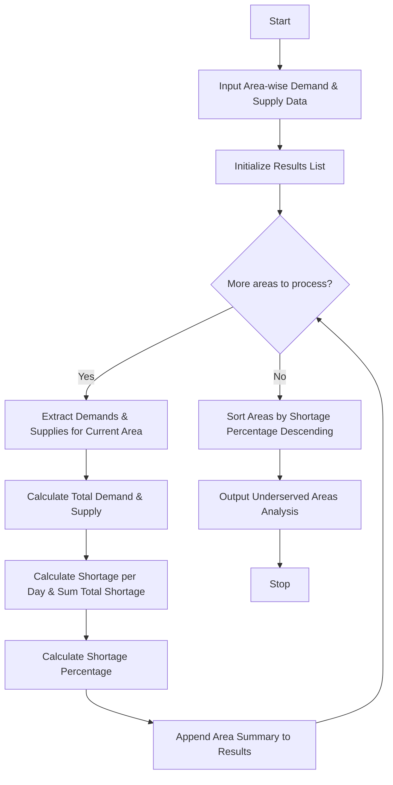

## Problem Statement

Design a program to perform a water distribution fairness analysis across multiple areas over several days. The program must ingest daily water demand and supply figures for each area, calculate total shortages, compute shortage percentages, compare distribution levels, and rank the areas to identify the most underserved locations.

---

## Algorithm

1. **Accept** a collection of area records containing area names, daily water demands, and daily water supplies.
2. **Initialize** an empty list to store computed summaries for each area.
3. **Iterate** through each area record:
* Calculate the total demand by summing all daily demands.
* Calculate the total supply by summing all daily supplies.
* Calculate the total shortage by summing max(0, demand - supply) for each day.
* Compute the shortage percentage relative to total demand.
* Store the metrics for the current area.


4. **Sort** the analyzed areas in descending order based on their shortage percentage to prioritize the most underserved areas.
5. **Return** or display the sorted fairness analysis results.

---

## Flowchart



---

## Python Source Code

```python
def analyze_water_distribution(areas_data):
    results = []
    for area in areas_data:
        name = area["name"]
        demands = area["demands"]
        supplies = area["supplies"]
        
        total_demand = sum(demands)
        total_supply = sum(supplies)
        total_shortage = sum(max(0, d - s) for d, s in zip(demands, supplies))
        shortage_percentage = (total_shortage / total_demand * 100) if total_demand > 0 else 0
        
        results.append({
            "area": name,
            "total_demand": total_demand,
            "total_supply": total_supply,
            "total_shortage": total_shortage,
            "shortage_percentage": shortage_percentage
        })
        
    results.sort(key=lambda x: x["shortage_percentage"], reverse=True)
    return results

if __name__ == "__main__":
    sample_areas = [
        {
            "name": "Area A",
            "demands": [1000, 1200, 1100, 1150],
            "supplies": [800, 900, 1000, 850]
        },
        {
            "name": "Area B",
            "demands": [1500, 1400, 1600, 1550],
            "supplies": [1500, 1400, 1500, 1500]
        },
        {
            "name": "Area C",
            "demands": [800, 850, 900, 820],
            "supplies": [500, 550, 600, 500]
        }
    ]
    
    analysis = analyze_water_distribution(sample_areas)
    import json
    print(json.dumps(analysis, indent=2))

```

---

## Sample Input

```json
[
  {
    "name": "Area A",
    "demands": [1000, 1200, 1100, 1150],
    "supplies": [800, 900, 1000, 850]
  },
  {
    "name": "Area B",
    "demands": [1500, 1400, 1600, 1550],
    "supplies": [1500, 1400, 1500, 1500]
  },
  {
    "name": "Area C",
    "demands": [800, 850, 900, 820],
    "supplies": [500, 550, 600, 500]
  }
]

```

---

## Sample Output

```json
[
  {
    "area": "Area C",
    "total_demand": 3370,
    "total_supply": 2150,
    "total_shortage": 1220,
    "shortage_percentage": 36.19881305637982
  },
  {
    "area": "Area A",
    "total_demand": 4450,
    "total_supply": 3550,
    "total_shortage": 900,
    "shortage_percentage": 20.224719101123595
  },
  {
    "area": "Area B",
    "total_demand": 6050,
    "total_supply": 5900,
    "total_shortage": 150,
    "shortage_percentage": 2.4793388429752066
  }
]

```
