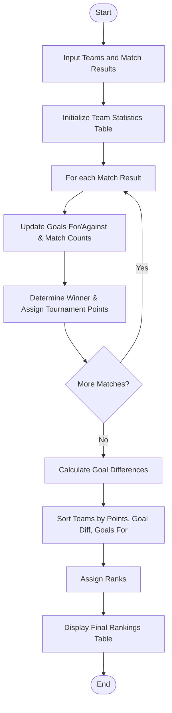

Here is the complete solution for the **Sports Tournament Ranking System**, provided with the problem statement, algorithm, Mermaid flowchart, Python source code (strictly without comments), sample input, and sample output.

---

 1. Problem Statement

Managing a sports league requires tracking match outcomes, computing standings, and ranking teams accurately.

Given a list of participating teams and individual match scores (Home Team, Away Team, Home Score, Away Score):

Objective:** Process all match results, calculate overall match statistics (Played, Won, Drawn, Lost, Goals For, Goals Against, Goal Difference, Points), apply standard competition tie-break rules, and generate final tournament rankings.

---

 2. Algorithm

1. Initialize Statistics:** Create a data structure for each team with starting values set to zero for points and match records.
2. Process Match Results: Loop through each match record:
* Increment matches played for both teams.
* Update goals scored and goals conceded for both teams.
* Determine the outcome: assign 3 points for a win, 1 point for a draw, and 0 points for a loss, updating win/loss/draw counters accordingly.


3. Calculate Tie-Breakers: Compute Goal Difference (`GD = GF - GA`) for each team.
4. Sort and Rank: Sort teams using primary and secondary ranking policies:
* Primary: Total Points (`Pts`) descending.
* Secondary: Goal Difference (`GD`) descending.
* Tertiary: Goals For (`GF`) descending.


5. Output Standings: Assign sequential ranks and display the sorted table.

---

 3. Flowchart (Mermaid)



---

 4. Python Source Code

```python
def calculate_rankings(teams, matches):
    stats = {team: {"P": 0, "W": 0, "D": 0, "L": 0, "GF": 0, "GA": 0, "GD": 0, "Pts": 0} for team in teams}
    
    for home, away, home_score, away_score in matches:
        stats[home]["P"] += 1
        stats[away]["P"] += 1
        stats[home]["GF"] += home_score
        stats[home]["GA"] += away_score
        stats[away]["GF"] += away_score
        stats[away]["GA"] += home_score
        
        if home_score > away_score:
            stats[home]["W"] += 1
            stats[home]["Pts"] += 3
            stats[away]["L"] += 1
        elif home_score < away_score:
            stats[away]["W"] += 1
            stats[away]["Pts"] += 3
            stats[home]["L"] += 1
        else:
            stats[home]["D"] += 1
            stats[home]["Pts"] += 1
            stats[away]["D"] += 1
            stats[away]["Pts"] += 1
            
    for team in stats:
        stats[team]["GD"] = stats[team]["GF"] - stats[team]["GA"]
        
    ranked_teams = sorted(
        stats.items(),
        key=lambda x: (x[1]["Pts"], x[1]["GD"], x[1]["GF"]),
        reverse=True
    )
    
    standings = []
    for rank, (team, data) in enumerate(ranked_teams, start=1):
        standings.append({
            "Rank": rank,
            "Team": team,
            "P": data["P"],
            "W": data["W"],
            "D": data["D"],
            "L": data["L"],
            "GF": data["GF"],
            "GA": data["GA"],
            "GD": data["GD"],
            "Pts": data["Pts"]
        })
        
    return standings


if __name__ == "__main__":
    teams = ["Team Alpha", "Team Beta", "Team Gamma", "Team Delta"]
    matches = [
        ("Team Alpha", "Team Beta", 2, 1),
        ("Team Gamma", "Team Delta", 0, 0),
        ("Team Alpha", "Team Gamma", 1, 1),
        ("Team Beta", "Team Delta", 3, 2),
        ("Team Alpha", "Team Delta", 4, 1),
        ("Team Beta", "Team Gamma", 2, 2)
    ]
    
    standings = calculate_rankings(teams, matches)
    
    print("Rank | Team       | P | W | D | L | GF | GA | GD | Pts")
    print("-" * 55)
    for s in standings:
        print(f"{s['Rank']:<4} | {s['Team']:<10} | {s['P']} | {s['W']} | {s['D']} | {s['L']} | {s['GF']} | {s['GA']} | {s['GD']:+2d} | {s['Pts']}")

```

---

 5. Sample Input
Teams: `["Team Alpha", "Team Beta", "Team Gamma", "Team Delta"]`
Matches `(Home Team, Away Team, Home Score, Away Score)`:**
```python
[
    ("Team Alpha", "Team Beta", 2, 1),
    ("Team Gamma", "Team Delta", 0, 0),
    ("Team Alpha", "Team Gamma", 1, 1),
    ("Team Beta", "Team Delta", 3, 2),
    ("Team Alpha", "Team Delta", 4, 1),
    ("Team Beta", "Team Gamma", 2, 2)
]

```


---

 6. Sample Output

```text
Rank | Team       | P | W | D | L | GF | GA | GD | Pts
-------------------------------------------------------
1    | Team Alpha | 3 | 2 | 1 | 0 | 7  | 3  | +4 | 7
2    | Team Beta  | 3 | 1 | 1 | 1 | 6  | 6  | +0 | 4
3    | Team Gamma | 3 | 0 | 3 | 0 | 3  | 3  | +0 | 3
4    | Team Delta | 3 | 0 | 1 | 2 | 3  | 7  | -4 | 1

```
