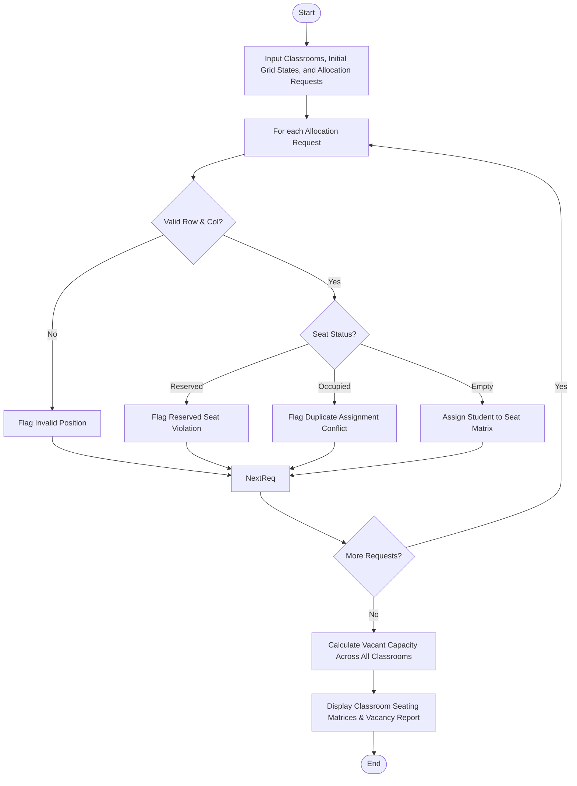

Here is the complete solution for the **Nested List Classroom Occupancy Analysis**, structured according to your requirements without any comments in the Python code.

---

## 1. Problem Statement

Managing classroom seating across an institution requires tracking seat availability, respecting pre-assigned reservations, and avoiding double-booking.

Given multiple classrooms represented as nested lists (2D grids where each cell denotes a seat status like `Empty`, `Reserved`, or a student's name):

* **Objective:** Allocate students to specific seating positions, preserve reserved seats, detect and prevent duplicate or invalid assignments, and calculate the total vacant capacity remaining across the classrooms.

---

## 2. Algorithm

1. **Initialize Classrooms:** Set up a dictionary of classrooms where each classroom is a 2D list initialized with seat states (`"Empty"`, `"Reserved"`, or a student identifier).
2. **Allocation Request Handling:** For each student assignment request (`Classroom`, `Row`, `Col`, `Student Name`):
* Validate if the row and column indices exist within the classroom's nested list dimensions.
* Check the target seat's current status:
* If the seat is `"Reserved"`, reject allocation to preserve the reserved spot.
* If the seat already contains a student name, detect a **duplicate/conflict assignment** and reject.
* If the seat is `"Empty"`, assign the student name to that position.


3. **Capacity Calculation:** Iterate through all classrooms and count every cell marked as `"Empty"`.
4. **Output Generation:** Display the updated seating matrices and the calculated vacant capacities.

---

## 3. Flowchart (Mermaid)



---

## 4. Python Source Code

```python
def allocate_seat(classrooms, classroom_name, row, col, student_name):
    if classroom_name not in classrooms:
        return f"Error: Classroom '{classroom_name}' does not exist."
    
    grid = classrooms[classroom_name]
    
    if row < 0 or row >= len(grid) or col < 0 or col >= len(grid[0]):
        return f"Error: Seat position ({row}, {col}) is out of bounds for {classroom_name}."
    
    current_status = grid[row][col]
    
    if current_status == "Reserved":
        return f"Conflict: Seat ({row}, {col}) in {classroom_name} is RESERVED and cannot be allocated."
    elif current_status != "Empty":
        return f"Conflict: Seat ({row}, {col}) in {classroom_name} is already assigned to {current_status} (Duplicate Assignment)."
    
    grid[row][col] = student_name
    return f"Success: Allocated seat ({row}, {col}) in {classroom_name} to {student_name}."


def calculate_vacant_capacity(classrooms):
    vacancy_report = {}
    total_vacant = 0
    
    for name, grid in classrooms.items():
        vacant_count = sum(row.count("Empty") for row in grid)
        vacancy_report[name] = vacant_count
        total_vacant += vacant_count
        
    return vacancy_report, total_vacant


if __name__ == "__main__":
    classrooms = {
        "Room 101": [
            ["Empty", "Reserved", "Empty"],
            ["Empty", "Empty", "Reserved"],
            ["Empty", "Empty", "Empty"]
        ],
        "Room 102": [
            ["Reserved", "Empty", "Empty"],
            ["Empty", "Reserved", "Empty"]
        ]
    }
    
    requests = [
        ("Room 101", 0, 0, "Alice"),
        ("Room 101", 0, 1, "Bob"),
        ("Room 101", 2, 2, "Alice"),
        ("Room 101", 2, 2, "Charlie"),
        ("Room 102", 0, 1, "David")
    ]
    
    print("=== ALLOCATION PROCESSING ===")
    for req in requests:
        result = allocate_seat(classrooms, req[0], req[1], req[2], req[3])
        print(result)
        
    vacancy, total = calculate_vacant_capacity(classrooms)
    
    print("\n=== VACANT CAPACITY REPORT ===")
    for room, count in vacancy.items():
        print(f"{room}: {count} vacant seats")
    print(f"Total Institutional Vacancy: {total} seats")
    
    print("\n=== FINAL CLASSROOM MATRICES ===")
    for room, grid in classrooms.items():
        print(f"\n{room}:")
        for r in grid:
            print(r)

```

---

## 5. Sample Input

* **Classrooms Data Structure (Nested Lists):**
```python
{
    "Room 101": [
        ["Empty", "Reserved", "Empty"],
        ["Empty", "Empty", "Reserved"],
        ["Empty", "Empty", "Empty"]
    ],
    "Room 102": [
        ["Reserved", "Empty", "Empty"],
        ["Empty", "Reserved", "Empty"]
    ]
}

```


* **Allocation Requests `(Classroom, Row, Col, Student Name)`:**
```python
[
    ("Room 101", 0, 0, "Alice"),       # Valid empty seat
    ("Room 101", 0, 1, "Bob"),         # Attempt to book a Reserved seat (Conflict)
    ("Room 101", 2, 2, "Charlie"),     # Valid empty seat
    ("Room 101", 2, 2, "David"),       # Attempt to book an already occupied seat (Duplicate Assignment)
    ("Room 102", 0, 1, "Eve")          # Valid empty seat
]

```


---

## 6. Sample Output

```text
=== ALLOCATION PROCESSING ===
Success: Allocated seat (0, 0) in Room 101 to Alice.
Conflict: Seat (0, 1) in Room 101 is RESERVED and cannot be allocated.
Success: Allocated seat (2, 2) in Room 101 to Charlie.
Conflict: Seat (2, 2) in Room 101 is already assigned to Charlie (Duplicate Assignment).
Success: Allocated seat (0, 1) in Room 102 to Eve.

=== VACANT CAPACITY REPORT ===
Room 101: 5 vacant seats
Room 102: 2 vacant seats
Total Institutional Vacancy: 7 seats

=== FINAL CLASSROOM MATRICES ===

Room 101:
['Alice', 'Reserved', 'Empty']
['Empty', 'Empty', 'Reserved']
['Empty', 'Empty', 'Charlie']

Room 102:
['Reserved', 'Eve', 'Empty']
['Empty', 'Reserved', 'Empty']

```
