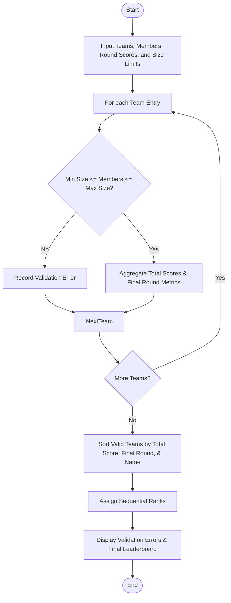

Here is the complete solution for the **Hackathon Team Formation and Ranking** problem, structured according to your requirements without any comments in the Python code.

---

## 1. Problem Statement

Managing a hackathon involves processing multiple team submissions, validating team composition constraints (such as min/max members), aggregating scores across multiple evaluation rounds, and resolving ties using predefined tie-breaking policies.

Given a dataset of teams, their members, and round-wise evaluation scores:

* **Objective:** Validate team sizes, filter out invalid teams, aggregate total scores, apply tie-breaking rules (e.g., final round score and alphabetical team name), and generate the final official hackathon leaderboard.

---

## 2. Algorithm

1. **Input Collection:** Receive the list of teams containing team names, member lists, and round scores, along with size boundaries (`min_size`, `max_size`).
2. **Team Validation Pass:** Iterate through each team entry:
* Check if the number of members falls within the allowed range.
* If invalid, log an error and exclude the team from ranking.
* If valid, calculate the total aggregate score and extract tie-breaker metrics (such as the final round score).


3. **Sorting and Tie-Resolution:** Sort the valid teams using a multi-level criteria policy:
* Primary: Total Score (descending)
* Secondary: Final Round Score (descending)
* Tertiary: Team Name (alphabetical ascending/descending)


4. **Rank Assignment:** Assign sequential rank numbers to the sorted teams.
5. **Output Generation:** Display validation errors and the final ranked leaderboard table.

---

## 3. Flowchart (Mermaid)



---

## 4. Python Source Code

```python
def process_hackathon_teams(teams_data, min_size=2, max_size=4):
    valid_teams = []
    errors = []
    
    for team_name, members, rounds in teams_data:
        if not (min_size <= len(members) <= max_size):
            errors.append(f"Team '{team_name}' rejected: Invalid member count ({len(members)}). Allowed: {min_size}-{max_size}.")
            continue
        
        total_score = sum(rounds)
        final_round_score = rounds[-1] if rounds else 0
        
        valid_teams.append({
            "team_name": team_name,
            "members": members,
            "rounds": rounds,
            "total_score": total_score,
            "final_round_score": final_round_score
        })
        
    valid_teams.sort(key=lambda x: (x["total_score"], x["final_round_score"], x["team_name"]), reverse=True)
    
    ranked_teams = []
    for rank, team in enumerate(valid_teams, start=1):
        ranked_teams.append({
            "rank": rank,
            "team_name": team["team_name"],
            "members": team["members"],
            "total_score": team["total_score"]
        })
        
    return ranked_teams, errors


if __name__ == "__main__":
    teams_data = [
        ("CodeStorm", ["Alice", "Bob", "Charlie"], [85, 90, 95]),
        ("ByteForce", ["David", "Eve"], [90, 85, 95]),
        ("NullPointer", ["Frank", "Grace", "Heidi"], [80, 80, 90]),
        ("SoloCoders", ["Ivan"], [95, 95, 95]),
        ("SyntaxError", ["Jack", "Mallory", "Niaj", "Olivia", "Peggy"], [70, 70, 70]),
        ("BitCrafters", ["Syed", "Zack", "John"], [85, 90, 95])
    ]
    
    rankings, validation_errors = process_hackathon_teams(teams_data, min_size=2, max_size=4)
    
    print("=== VALIDATION & ELIGIBILITY REPORT ===")
    for err in validation_errors:
        print(err)
        
    print("\n=== FINAL HACKATHON LEADERBOARD ===")
    print("Rank | Team Name    | Total Score | Members")
    print("-" * 50)
    for r in rankings:
        members_str = ", ".join(r['members'])
        print(f"{r['rank']:<4} | {r['team_name']:<12} | {r['total_score']:<11} | {members_str}")

```

---

## 5. Sample Input

* **Team Rules:** Minimum size = 2, Maximum size = 4 members.
* **Teams Data `(Team Name, Members List, Round Scores List)`:**
```python
[
    ("CodeStorm", ["Alice", "Bob", "Charlie"], [85, 90, 95]),
    ("ByteForce", ["David", "Eve"], [90, 85, 95]),
    ("NullPointer", ["Frank", "Grace", "Heidi"], [80, 80, 90]),
    ("SoloCoders", ["Ivan"], [95, 95, 95]),  # Fails min size constraint (1 member)
    ("SyntaxError", ["Jack", "Mallory", "Niaj", "Olivia", "Peggy"], [70, 70, 70]),  # Fails max size constraint (5 members)
    ("BitCrafters", ["Syed", "Zack", "John"], [85, 90, 95])  # Ties with CodeStorm total score
]

```


---

## 6. Sample Output

```text
=== VALIDATION & ELIGIBILITY REPORT ===
Team 'SoloCoders' rejected: Invalid member count (1). Allowed: 2-4.
Team 'SyntaxError' rejected: Invalid member count (5). Allowed: 2-4.

=== FINAL HACKATHON LEADERBOARD ===
Rank | Team Name    | Total Score | Members
--------------------------------------------------
1    | BitCrafters  | 270         | Syed, Zack, John
2    | CodeStorm    | 270         | Alice, Bob, Charlie
3    | ByteForce    | 270         | David, Eve
4    | NullPointer  | 250         | Frank, Grace, Heidi

```
