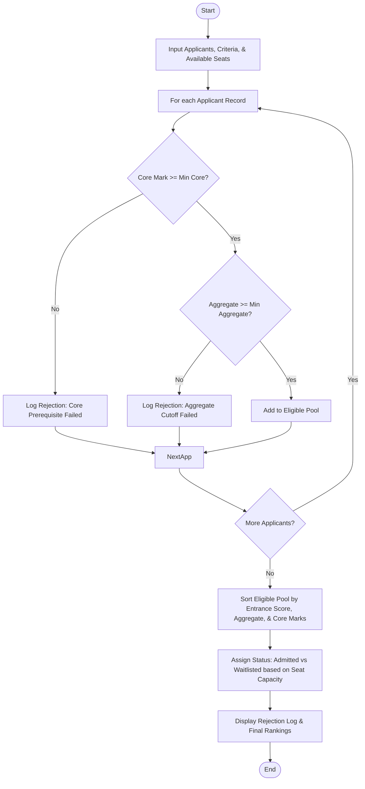

Here is the complete solution for the **University Admission Decision Engine**, structured according to your requirements without any comments in the Python code.

---

## 1. Problem Statement

Processing university applications requires strict adherence to institutional policies, including minimum prerequisite subject grades, overall aggregate cutoffs, entrance exam scores, and capacity limits.

Given a list of applicants with their academic credentials and a set of course criteria:

* **Objective:** Evaluate each applicant against eligibility rules, filter out ineligible candidates, rank the qualified pool using tie-breaking criteria (Entrance Score $\rightarrow$ Aggregate Marks $\rightarrow$ Core Subject Marks), and assign applicants to admitted or waitlisted statuses based on available seat capacity.

---

## 2. Algorithm

1. **Input Collection:** Receive applicant records, course threshold criteria (`min_aggregate`, `min_core_subject`), and total available seats.
2. **Eligibility Filtering Pass:** Loop through each applicant:
* Check if the core subject mark meets or exceeds the minimum prerequisite threshold.
* Check if the academic aggregate meets or exceeds the minimum cutoff.
* If any check fails, log the rejection reason and exclude the candidate.
* If all checks pass, add the candidate to the eligible applicant pool.


3. **Sorting & Tie-Resolution:** Sort the eligible applicants using a multi-level criteria policy:
* Primary: Entrance Score (descending)
* Secondary: Aggregate Marks (descending)
* Tertiary: Core Subject Mark (descending)


4. **Seat Allocation:** Assign sorted candidates to **Admitted** status up to the available seat limit, and place remaining candidates on the **Waitlist**.
5. **Output Generation:** Display the rejection logs and the final prioritized admission leaderboard.

---

## 3. Flowchart (Mermaid)



---

## 4. Python Source Code

```python
def evaluate_admissions(applicants, criteria, available_seats):
    eligible_pool = []
    rejection_log = []
    
    min_aggregate = criteria["min_aggregate"]
    min_core_subject = criteria["min_core_subject"]
    
    for applicant in applicants:
        name, core_mark, aggregate, entrance_score = applicant
        
        if core_mark < min_core_subject:
            rejection_log.append((name, f"Failed core subject threshold ({core_mark} < {min_core_subject})"))
            continue
            
        if aggregate < min_aggregate:
            rejection_log.append((name, f"Failed aggregate threshold ({aggregate} < {min_aggregate})"))
            continue
            
        eligible_pool.append({
            "name": name,
            "core_mark": core_mark,
            "aggregate": aggregate,
            "entrance_score": entrance_score
        })
        
    eligible_pool.sort(
        key=lambda x: (x["entrance_score"], x["aggregate"], x["core_mark"]),
        reverse=True
    )
    
    admitted = []
    waitlisted = []
    
    for index, candidate in enumerate(eligible_pool):
        if index < available_seats:
            candidate["status"] = "Admitted"
            admitted.append(candidate)
        else:
            candidate["status"] = "Waitlisted"
            waitlisted.append(candidate)
            
    return admitted, waitlisted, rejection_log


if __name__ == "__main__":
    criteria = {
        "min_aggregate": 75.0,
        "min_core_subject": 70
    }
    available_seats = 3
    
    applicants = [
        ("Alice Smith", 85, 88.5, 92),
        ("Bob Jones", 65, 82.0, 88),
        ("Charlie Brown", 90, 91.0, 95),
        ("Diana Prince", 78, 80.0, 85),
        ("Ethan Hunt", 72, 74.5, 70),
        ("Fiona Gallagher", 88, 88.5, 92)
    ]
    
    admitted, waitlisted, rejections = evaluate_admissions(applicants, criteria, available_seats)
    
    print("=== REJECTION LOG ===")
    for name, reason in rejections:
        print(f"{name}: {reason}")
        
    print("\n=== ADMISSION & WAITLIST RANKINGS ===")
    print("Rank | Status     | Name            | Entrance | Aggregate | Core")
    print("-" * 60)
    
    combined = admitted + waitlisted
    for rank, c in enumerate(combined, start=1):
        print(f"{rank:<4} | {c['status']:<10} | {c['name']:<15} | {c['entrance_score']:<8} | {c['aggregate']:<9} | {c['core_mark']}")

```

---

## 5. Sample Input

* **Course Criteria:**
* Minimum Aggregate: `75.0`
* Minimum Core Subject Mark: `70`
* Available Capacity: `3 Seats`


* **Applicants List `(Name, Core Mark, Aggregate, Entrance Score)`:**
```python
[
    ("Alice Smith", 85, 88.5, 92),
    ("Bob Jones", 65, 82.0, 88),         # Fails core subject threshold (65 < 70)
    ("Charlie Brown", 90, 91.0, 95),
    ("Diana Prince", 78, 80.0, 85),
    ("Ethan Hunt", 72, 74.5, 70),        # Fails aggregate threshold (74.5 < 75.0)
    ("Fiona Gallagher", 88, 88.5, 92)    # Ties with Alice on entrance & aggregate, lower core
]

```


---

## 6. Sample Output

```text
=== REJECTION LOG ===
Bob Jones: Failed core subject threshold (65 < 70)
Ethan Hunt: Failed aggregate threshold (74.5 < 75.0)

=== ADMISSION & WAITLIST RANKINGS ===
Rank | Status     | Name            | Entrance | Aggregate | Core
------------------------------------------------------------
1    | Admitted   | Charlie Brown   | 95       | 91.0      | 90
2    | Admitted   | Alice Smith     | 92       | 88.5      | 85
3    | Admitted   | Fiona Gallagher | 92       | 88.5      | 88
4    | Waitlisted | Diana Prince    | 85       | 80.0      | 78

```
