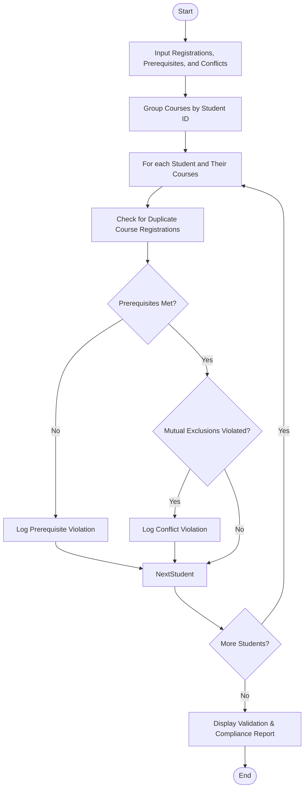

Here is the complete solution for the **Tuple-Based Course Registration Validation** problem, structured according to your requirements without any comments in the Python code.

---

## 1. Problem Statement

Academic institutions enforce strict curriculum policies during course enrollment. Managing student registrations requires checking data integrity to prevent duplicate sign-ups and rule violations.

Given a list of course registrations represented as tuples `(Student ID, Course Code)`, along with institutional rules (such as prerequisites and mutually exclusive course pairs):

* **Objective:** Parse student course selections, detect duplicate registrations, identify prerequisite and conflict violations, and produce a compliance report listing students whose selections violate the rules.

---

## 2. Algorithm

1. **Input Collection:** Receive course registrations as a list of tuples, along with prerequisite requirements and conflicting course pairs.
2. **Data Grouping:** Aggregate all course choices for each student ID into a unified list.
3. **Violation Analysis Pass:** For each student, evaluate their course selections against three rules:
* **Duplicate Detection:** Check if a course appears more than once in the student's selection list.
* **Prerequisite Verification:** Check if required prerequisite courses for any selected advanced course are present in the student's selections.
* **Conflict Checking:** Check if any mutually exclusive course pairs are simultaneously selected.


4. **Report Generation:** Compile students who triggered any violations along with their specific infractions into a final report.

---

## 3. Flowchart (Mermaid)



---


## 4. Sample Input

* **Registrations (tuples of `(Student ID, Course Code)`):**
```python
[
    ("S101", "CS101"),
    ("S101", "CS102"),
    ("S101", "CS101"),  # Duplicate registration for S101
    ("S102", "CS102"),  # Missing prerequisite CS101 for S102
    ("S103", "CS103"),  # Missing prerequisite CS101 for S103
    ("S103", "CS101"),
    ("S104", "MATH201"),
    ("S104", "MATH202")   # Mutually exclusive conflict for S104
]

```


* **Prerequisites Rule:** `{"CS102": "CS101", "CS103": "CS101"}`
* **Conflict Rule:** `[("MATH201", "MATH202")]`

---

## 5. Sample Output

```text
=== REGISTRATION VALIDATION REPORT ===

Student ID: S101
Selected Courses: ['CS101', 'CS102', 'CS101']
Violations Found:
  - Duplicate registration for course: CS101

Student ID: S102
Selected Courses: ['CS102']
Violations Found:
  - Missing prerequisite 'CS101' for course 'CS102'

Student ID: S103
Selected Courses: ['CS103', 'CS101']
Violations Found:
  - Missing prerequisite 'CS101' for course 'CS103'

Student ID: S104
Selected Courses: ['MATH201', 'MATH202']
Violations Found:
  - Mutually exclusive courses selected: 'MATH201' and 'MATH202'

```
