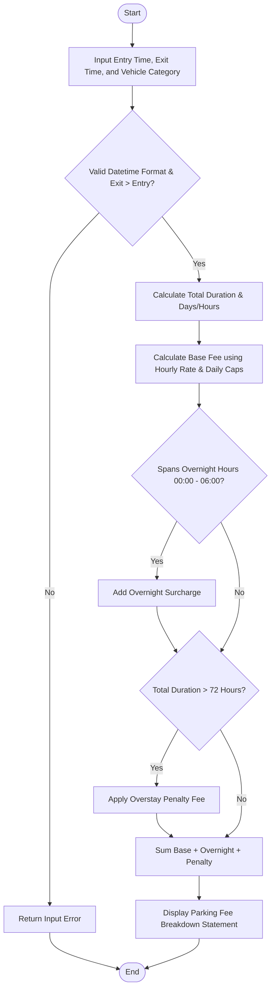

Here is the complete solution for the **Smart Parking Fee Management** system, structured according to your requirements without any comments in the Python code.

---

## 1. Problem Statement

Managing a parking facility requires calculating accurate fees based on various parameters such as vehicle classification, duration of stay, overnight parking presence, maximum daily fee caps, and penalty conditions for overstaying, while validating all time entries.

Given an entry timestamp, an exit timestamp, and a vehicle category:

* **Objective:** Validate time inputs, compute parking duration, calculate base rates using category-specific hourly and daily caps, add overnight surcharges, apply penalty conditions for extended stays, and generate the final parking fee statement.

---

## 2. Algorithm

1. **Input Collection & Validation:** Accept entry time, exit time, and vehicle category. Validate timestamp format and ensure exit time is strictly after entry time.
2. **Duration Calculation:** Compute the total duration and breakdown into days and remaining hours.
3. **Base Fee Calculation:** Determine charges based on category rates, applying hourly rates or daily maximum caps where applicable.
4. **Overnight Surcharge Calculation:** Check if the parking interval spans across overnight hours (e.g., between 00:00 and 06:00) and apply respective surcharges.
5. **Penalty Evaluation:** Apply a penalty fee if the total parking duration exceeds the maximum permitted duration limit (e.g., 72 hours).
6. **Total Fee Aggregation:** Sum up base fees, overnight fees, and penalties, then output the final statement.

---

## 3. Flowchart (Mermaid)



---

## 4. Python Source Code

```python
from datetime import datetime, timedelta

def calculate_parking_fee(entry_str, exit_str, category):
    try:
        entry_time = datetime.strptime(entry_str, "%Y-%m-%d %H:%M")
        exit_time = datetime.strptime(exit_str, "%Y-%m-%d %H:%M")
    except ValueError:
        return {"error": "Invalid date/time format. Use YYYY-MM-DD HH:MM"}
        
    if exit_time <= entry_time:
        return {"error": "Exit time must be later than entry time."}
        
    duration = exit_time - entry_time
    total_hours = duration.total_seconds() / 3600
    
    rates = {
        "Car": {"hourly": 10.0, "daily_max": 120.0, "overnight": 20.0},
        "Bike": {"hourly": 5.0, "daily_max": 50.0, "overnight": 10.0},
        "Truck": {"hourly": 20.0, "daily_max": 250.0, "overnight": 40.0}
    }
    
    if category not in rates:
        return {"error": "Invalid vehicle category."}
        
    rate_info = rates[category]
    
    days = duration.days
    remaining_hours = total_hours - (days * 24)
    
    base_fee = 0.0
    if days > 0:
        base_fee += days * rate_info["daily_max"]
    
    calculated_hourly_fee = remaining_hours * rate_info["hourly"]
    if calculated_hourly_fee > rate_info["daily_max"]:
        base_fee += rate_info["daily_max"]
    else:
        base_fee += calculated_hourly_fee
        
    overnight_fee = 0.0
    current = entry_time
    while current < exit_time:
        next_midnight = datetime(current.year, current.month, current.day) + timedelta(days=1)
        check_end = min(exit_time, next_midnight)
        
        night_start = datetime(current.year, current.month, current.day, 0, 0)
        night_end = datetime(current.year, current.month, current.day, 6, 0)
        
        if current < night_end and check_end > night_start:
            overnight_fee += rate_info["overnight"]
            
        current = next_midnight
        
    penalty = 0.0
    if total_hours > 72:
        penalty = 50.0
        
    total_fee = base_fee + overnight_fee + penalty
    
    return {
        "entry": entry_str,
        "exit": exit_str,
        "category": category,
        "total_hours": round(total_hours, 2),
        "base_fee": round(base_fee, 2),
        "overnight_fee": round(overnight_fee, 2),
        "penalty": round(penalty, 2),
        "total_fee": round(total_fee, 2)
    }

if __name__ == "__main__":
    test_cases = [
        ("2026-06-01 10:00", "2026-06-01 14:30", "Car"),
        ("2026-06-01 22:00", "2026-06-02 08:00", "Car"),
        ("2026-06-01 08:00", "2026-06-05 12:00", "Truck"),
        ("2026-06-01 12:00", "2026-06-01 10:00", "Bike")
    ]
    
    for entry, exit_t, cat in test_cases:
        res = calculate_parking_fee(entry, exit_t, cat)
        print(res)

```

---

## 5. Sample Input

* **Test Case 1:** Entry: `"2026-06-01 10:00"`, Exit: `"2026-06-01 14:30"`, Category: `"Car"`
* **Test Case 2:** Entry: `"2026-06-01 22:00"`, Exit: `"2026-06-02 08:00"`, Category: `"Car"` (Includes overnight stay)
* **Test Case 3:** Entry: `"2026-06-01 08:00"`, Exit: `"2026-06-05 12:00"`, Category: `"Truck"` (Exceeds 72h limit, triggers penalty)
* **Test Case 4:** Entry: `"2026-06-01 12:00"`, Exit: `"2026-06-01 10:00"`, Category: `"Bike"` (Invalid time validation check)

---

## 6. Sample Output

```text
{'entry': '2026-06-01 10:00', 'exit': '2026-06-01 14:30', 'category': 'Car', 'total_hours': 4.5, 'base_fee': 45.0, 'overnight_fee': 0.0, 'penalty': 0.0, 'total_fee': 45.0}
{'entry': '2026-06-01 22:00', 'exit': '2026-06-02 08:00', 'category': 'Car', 'total_hours': 10.0, 'base_fee': 100.0, 'overnight_fee': 20.0, 'penalty': 0.0, 'total_fee': 120.0}
{'entry': '2026-06-01 08:00', 'exit': '2026-06-05 12:00', 'category': 'Truck', 'total_hours': 100.0, 'base_fee': 1020.0, 'overnight_fee': 160.0, 'penalty': 50.0, 'total_fee': 1230.0}
{'error': 'Exit time must be later than entry time.'}

```
