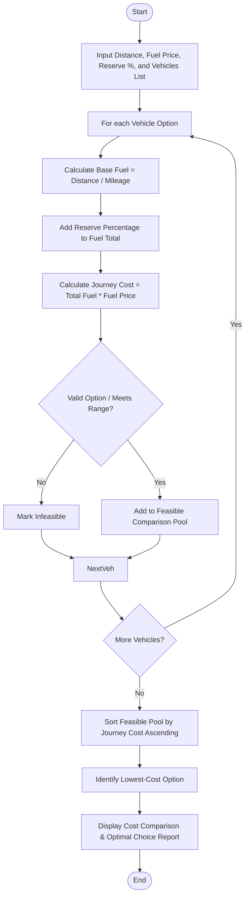

Here is the complete solution for the **Fuel Consumption and Route Comparison** problem, structured according to your requirements without any comments in the Python code.

---

## 1. Problem Statement

Planning road trips across various transport options requires computing fuel consumption, incorporating safety reserve margins, evaluating fluctuating fuel prices, and determining the most cost-effective feasible choice.

Given route distance, vehicle specifications (mileage/fuel efficiency), current fuel prices, and safety reserve requirements:

* **Objective:** Calculate total fuel required (including reserve percentage), compute journey cost for each vehicle option, filter out unfeasible options, and identify the lowest-cost feasible route and vehicle choice.

---

## 2. Algorithm

1. **Input Collection:** Receive route distance, vehicle details (name, mileage in km/l), local fuel price per liter, and required safety reserve percentage.
2. **Fuel Computation Pass:** For each vehicle option:
* Calculate base fuel needed: $\text{Base Fuel} = \frac{\text{Distance}}{\text{Mileage}}$.
* Apply reserve requirement: $\text{Total Fuel} = \text{Base Fuel} \times (1 + \frac{\text{Reserve } \%}{100})$.
* Calculate total cost: $\text{Journey Cost} = \text{Total Fuel} \times \text{Fuel Price}$.


3. **Feasibility Check:** Validate if the vehicle can complete the route or meets operational thresholds; add feasible options to a comparison pool.
4. **Lowest-Cost Optimization:** Sort feasible options by journey cost in ascending order to select the optimal choice.
5. **Output Generation:** Display the comparison metrics and recommend the lowest-cost option.

---

## 3. Flowchart (Mermaid)



---

## 4. Python Source Code

```python
def compare_fuel_routes(distance, fuel_price, reserve_percentage, vehicles):
    feasible_options = []
    
    for vehicle_name, mileage, tank_capacity in vehicles:
        if mileage <= 0:
            continue
            
        base_fuel = distance / mileage
        reserve_multiplier = 1.0 + (reserve_percentage / 100.0)
        total_fuel_needed = base_fuel * reserve_multiplier
        
        if total_fuel_needed > tank_capacity:
            continue
            
        journey_cost = total_fuel_needed * fuel_price
        
        feasible_options.append({
            "vehicle": vehicle_name,
            "mileage": mileage,
            "total_fuel": round(total_fuel_needed, 2),
            "journey_cost": round(journey_cost, 2)
        })
        
    if not feasible_options:
        return None, []
        
    feasible_options.sort(key=lambda x: x["journey_cost"])
    optimal_choice = feasible_options[0]
    
    return optimal_choice, feasible_options


if __name__ == "__main__":
    distance_km = 450.0
    fuel_price_per_liter = 1.25
    safety_reserve_pct = 15.0
    
    vehicle_fleet = [
        ("Sedan Efficiency", 15.0, 60.0),
        ("SUV Heavy", 9.5, 80.0),
        ("Compact Hatchback", 18.5, 45.0),
        ("Electric Crossover", 5.0, 30.0)
    ]
    
    optimal, comparison = compare_fuel_routes(distance_km, fuel_price_per_liter, safety_reserve_pct, vehicle_fleet)
    
    print(f"Route Distance: {distance_km} km | Fuel Price: ${fuel_price_per_liter}/L | Reserve: {safety_reserve_pct}%")
    print("\n=== VEHICLE COST COMPARISON REPORT ===")
    print("Vehicle Name      | Mileage (km/L) | Fuel Needed (L) | Journey Cost ($)")
    print("-" * 65)
    for opt in comparison:
        print(f"{opt['vehicle']:<18} | {opt['mileage']:<14} | {opt['total_fuel']:<15} | ${opt['journey_cost']}")
        
    if optimal:
        print(f"\n🏆 Optimal Lowest-Cost Option: {optimal['vehicle']} at ${optimal['journey_cost']}")
    else:
        print("\n❌ No feasible vehicle options available within fuel tank capacity limits.")

```

---

## 5. Sample Input

* **Route Distance:** `450.0 km`
* **Fuel Price:** `$1.25 per liter`
* **Safety Reserve Requirement:** `15.0%`
* **Vehicle Fleet `(Vehicle Name, Mileage (km/L), Max Fuel Tank Capacity (L))`:**
```python
[
    ("Sedan Efficiency", 15.0, 60.0),
    ("SUV Heavy", 9.5, 80.0),
    ("Compact Hatchback", 18.5, 45.0),
    ("Electric Crossover", 5.0, 30.0)   # Fails tank capacity limit for required fuel + reserve
]

```


---

## 6. Sample Output

```text
Route Distance: 450.0 km | Fuel Price: $1.25/L | Reserve: 15.0%

=== VEHICLE COST COMPARISON REPORT ===
Vehicle Name      | Mileage (km/L) | Fuel Needed (L) | Journey Cost ($)
-----------------------------------------------------------------
Compact Hatchback | 18.5           | 27.97           | $34.96
Sedan Efficiency  | 15.0           | 34.5            | $43.12
SUV Heavy         | 9.5            | 54.47           | $68.09

🏆 Optimal Lowest-Cost Option: Compact Hatchback at $34.96

```
